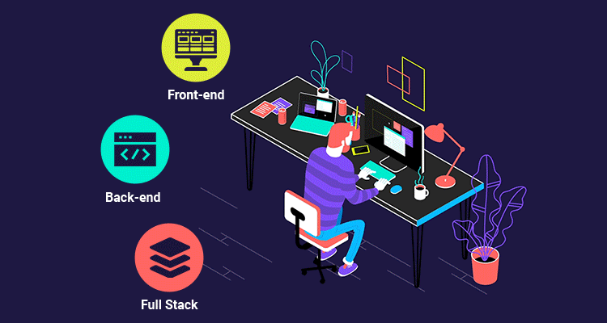

<div align="center">



<br/>

# Abdul Wahab

<p>
  <a href="mailto:wahabcreations2161@gmail.com"></a>
  <a href="https://www.linkedin.com/in/abdulwahab2161/"></a>
  <a href="https://wa.me/923115257482"></a>
  <a href="https://wahabcreations.vercel.app/"></a>
</p>


</div>

---


### 👋 About Me

```ts
const wahab = {
  role     : "Full Stack Engineer & Web Developer",
  stack    : ["React", "Next.js", "TypeScript", "Node.js", "Django REST"],
  databases: ["PostgreSQL", "MongoDB", "MySQL"],
  focus    : "Scalable apps · Clean architecture · Real impact",
  learning : ["System Design", "Cloud Infrastructure", "Performance Optimization"],
  openTo   : ["Full-Time", "Freelance", "Contract", "Consulting"],
  location : "Islamabad, Pakistan",
  contact  : "wahabcreations2161@gmail.com",
};
```

- 🔭 Building production-grade web applications with **Next.js + Django REST Framework**
- 💼 Web Developer with industry track record at **Phebsoft LLC**, **Versori**, and **TMRc**
- 🎓 BS Software Engineering from **Capital University of Science & Technology (CUST)** *(CGPA 3.29 / 4.0)*
- 🏆 Top-70 finish in the **ICPC Programming Contest** (~350 participants) & NAVTTC Certified MERN Stack Developer
- 🌱 Deep-diving into **system design**, **distributed architectures**, and **cloud infrastructure**
- 💡 Passionate about performance-driven, maintainable engineering and user-first digital products
- ⚡ Fun fact: I turn caffeine into scalable web apps

<br clear="right"/>

---

## 🛠️ Tech Stack

### Frontend


### Backend & Database


### DevOps & Cloud


---

## 🚀 Featured Projects

<table>
  <thead>
    <tr>
      <th>🏗️ Project</th>
      <th>📌 Description</th>
      <th>⚙️ Stack</th>
      <th>🔗 Live</th>
    </tr>
  </thead>
  <tbody>
    <tr>
      <td><b>🤖 Matchwise AI</b></td>
      <td>AI-powered career matching platform connecting candidates with roles based on O*NET benchmarks, skills analysis & dual evaluation workflows</td>
      <td><code>React</code> <code>Next.js</code> <code>Node.js</code> <code>AI / NLP</code></td>
      <td><a href="https://www.matchwise-ai.com" target="_blank">→ Visit</a></td>
    </tr>
    <tr>
      <td><b>🛡️ CMMC2Ready</b></td>
      <td>Cybersecurity compliance-readiness SaaS platform & automated SPRS assessment system for US defense contractors</td>
      <td><code>Next.js</code> <code>TypeScript</code> <code>Tailwind CSS</code></td>
      <td><a href="https://cmmc2ready.com" target="_blank">→ Visit</a></td>
    </tr>
    <tr>
      <td><b>🐾 JunniVet</b></td>
      <td>All-in-one veterinary clinic management SaaS platform with client appointment scheduling, pet EMR, and clinical logs</td>
      <td><code>Next.js</code> <code>TypeScript</code> <code>Tailwind CSS</code></td>
      <td><a href="https://junnivet.vercel.app" target="_blank">→ Visit</a></td>
    </tr>
    <tr>
      <td><b>🕌 MW Quran Academy</b></td>
      <td>Global online Quran learning academy serving 50,000+ students across 50+ countries with course pathways, 24/7 video streaming & automated trial booking</td>
      <td><code>Next.js</code> <code>React</code> <code>Tailwind CSS</code></td>
      <td><a href="https://mwquranacademy.vercel.app" target="_blank">→ Visit</a></td>
    </tr>
    <tr>
      <td><b>🎓 Capital Projects Management (PMS CUST)</b></td>
      <td>Full-lifecycle academic project management and evaluation platform with role-based dashboards for Students, Supervisors, and Coordinators</td>
      <td><code>Next.js</code> <code>React</code> <code>Tailwind CSS</code> <code>Cloudinary</code></td>
      <td><a href="https://pms-cust.vercel.app" target="_blank">→ Visit</a></td>
    </tr>
    <tr>
      <td><b>⚙️ Moatizco</b></td>
      <td>Commercial business and e-commerce portal for an international industrial spare parts distributor</td>
      <td><code>Next.js</code> <code>React</code> <code>Tailwind CSS</code></td>
      <td><a href="https://moatizco.com" target="_blank">→ Visit</a></td>
    </tr>
    <tr>
      <td><b>🍊 Chakwal Citrus Crop</b></td>
      <td>Agricultural business and export portal with pre-booking management and seasonal harvest catalog</td>
      <td><code>React</code> <code>Tailwind CSS</code></td>
      <td><a href="https://chakwalcitruscrop.com" target="_blank">→ Visit</a></td>
    </tr>
    <tr>
      <td><b>🌳 SG Citrus Farm</b></td>
      <td>Citrus farm business website supporting brand presentation, commercial inquiries, and customer discovery</td>
      <td><code>HTML5</code> <code>CSS3</code> <code>JavaScript</code></td>
      <td><a href="https://sgcitrusfarm.com" target="_blank">→ Visit</a></td>
    </tr>
    <tr>
      <td><b>🛍️ Savemore</b></td>
      <td>E-commerce savings, vouchers, and consumer deals platform</td>
      <td><code>Next.js</code> <code>Django</code> <code>PostgreSQL</code></td>
      <td><a href="https://savemore.cloud" target="_blank">→ Visit</a></td>
    </tr>
    <tr>
      <td><b>🔒 Zee Security</b></td>
      <td>Corporate security services and operational risk management website for UK clientele</td>
      <td><code>React</code> <code>Next.js</code> <code>Tailwind CSS</code></td>
      <td><a href="https://zeesecurity.co.uk" target="_blank">→ Visit</a></td>
    </tr>
    <tr>
      <td><b>✏️ Raw Editor</b></td>
      <td>Clean online raw text & code editor utility for developers</td>
      <td><code>React</code> <code>Next.js</code></td>
      <td><a href="https://raw-editor.vercel.app" target="_blank">→ Visit</a></td>
    </tr>
    <tr>
      <td><b>🛍️ The One Shop</b></td>
      <td>Modern responsive e-commerce storefront with shopping workflows</td>
      <td><code>Next.js</code> <code>React</code> <code>Tailwind CSS</code></td>
      <td><a href="https://theoneshop.vercel.app" target="_blank">→ Visit</a></td>
    </tr>
    <tr>
      <td><b>📖 Sirat-ul-Mustaqeem</b></td>
      <td>Clean, accessible Islamic educational portal with structured learning content</td>
      <td><code>React</code> <code>Next.js</code></td>
      <td><a href="https://seratulmustaqeem.vercel.app" target="_blank">→ Visit</a></td>
    </tr>
    <tr>
      <td><b>🏛️ LTI Portal</b></td>
      <td>Integrated Technology Institute landing page & student educational portal</td>
      <td><code>React</code> <code>Next.js</code></td>
      <td><a href="https://thelti.site" target="_blank">→ Visit</a></td>
    </tr>
    <tr>
      <td><b>🧑‍💻 Developer Portfolio</b></td>
      <td>Personal developer portfolio showcasing full-stack work, interactive terminal emulator, and live projects</td>
      <td><code>HTML5</code> <code>Vanilla CSS</code> <code>JavaScript</code></td>
      <td><a href="https://wahabcreations.vercel.app" target="_blank">→ Visit</a></td>
    </tr>
  </tbody>
</table>

---

## 📊 GitHub Analytics

<div align="center">

  <!-- Contribution activity graph -->

  


  <!-- Keep the stats cards in a table for consistent GitHub README alignment -->
  <table>
    <tr>
      <td width="50%" align="center" valign="top">
        
      </td>
      <td width="50%" align="center" valign="top">
        
      </td>
    </tr>
  </table>

  <sub>Analytics are provided by third-party services and may update with a delay. Language percentages reflect detected code in public repositories.</sub>
</div>

---

## 💼 Open To

<div align="center">

| 🧑‍💻 Full-Stack Roles | 🎨 Frontend Engineering | 🤝 Freelance & Contract | 🌍 Open Source | 📚 Consulting |
|:---:|:---:|:---:|:---:|:---:|
| Next.js / Django / MERN | React / TypeScript / Tailwind | Projects of any scale | Contributions & Architecture | System Design & Optimization |

</div>

---

<div align="center">

### 🤝 Let's Build Something Great Together

<p>
  <a href="mailto:wahabcreations2161@gmail.com">
    
  </a>
  &nbsp;
  <a href="https://wa.me/923115257482">
    
  </a>
  &nbsp;
  <a href="https://wahabcreations.vercel.app/">
    
  </a>
</p>


</div>
